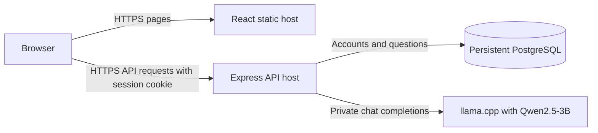

# CodeBridge AI frontend

The React application uses the Express API for registration, login, session restoration, and question management. It includes an administrator page with account counts and a Qwen-powered wording assistant. Usage reporting and the administrator user directory are planned for Milestone 2.

## Run locally

Use Node.js 20.19+ or 22.12+ and npm. Follow the [database guide](database.md) and [authentication guide](authentication.md) to configure the root `.env` and PostgreSQL. Set `CLIENT_ORIGIN=http://localhost:5173` and use `localhost` consistently for both services.

From the repository root, start PostgreSQL and the backend in one terminal:

```sh
docker compose up -d --wait postgres
npm --prefix backend ci
npm --prefix backend start
```

In a second terminal:

```sh
npm --prefix frontend ci
npm --prefix frontend run dev
```

Open [the local frontend](http://localhost:5173). Register and then log in to use question management, or follow the [demo account instructions](authentication.md#seed-the-course-demo-accounts) to exercise both roles in a disposable environment.

Create `frontend/.env.local` from `frontend/.env.example` if the API runs elsewhere. `VITE_API_BASE_URL` includes `/api/v1`. The development default is `http://localhost:3000/api/v1`. If port 3000 is occupied, set `PORT=3300` in the root `.env` and `VITE_API_BASE_URL=http://localhost:3300/api/v1` in `frontend/.env.local`, then restart both servers. Vite exposes variables prefixed with `VITE_` to the browser. Keep `JWT_SECRET` and the model server settings in the backend environment.

## Routes and permissions

| Page | Path | Behavior |
| --- | --- | --- |
| Login | `/login` | Sign in and return to the requested protected page. |
| Registration | `/register` | Create an account and continue to login. |
| My Questions | `/questions` | Search visible questions, filter to your own, and open a question. |
| Question details | `/questions/:id` | Read the question and open its editor if authorized. |
| Question editor | `/questions/new`, `/questions/:id/edit` | Create or update a question, review AI suggestions, or confirm deletion as the owner. |
| AI Assistant | `/assistant` | Start from a new or visible question and send an accepted suggestion to the editor for review. |
| API Usage | `/usage` | Show eligible calls, progress, notices, and a breakdown when available. |
| Administration | `/admin` | Show real account totals and any available directory and usage statistics. |
| Profile | `/profile` | Show account email, role, creation date, and logout. |

All signed-in accounts can read visible questions. Owners and administrators can edit. Deletion requires ownership. Express makes the final authorization decision.

The session provider reads `GET /auth/me` at startup. Browser requests include credentials so the browser can send the HttpOnly session cookie. JavaScript keeps the user profile in memory. Protected API responses with HTTP 401 end the local session and send the user to login. An interrupted draft stays in memory and is restored when the same account signs back in without reloading the app. A startup network error offers a retry.

## Frontend structure

```text
frontend/
├── public/                  Brand icon
├── src/
│   ├── components/          Navigation, feedback, question fields, and AI comparison
│   ├── context/             Cookie-backed session state
│   ├── hooks/               Resource loading and AI interaction
│   ├── pages/               Auth, questions, assistant, usage, and admin screens
│   ├── services/api.js      Fetch, errors, and API contracts
│   ├── App.jsx              Routes and authorization guards
│   ├── App.test.jsx         Interaction tests with mocked HTTP
│   ├── index.css            Responsive design and Tailwind CSS
│   └── main.jsx             React entry point
├── .env.example
├── index.html
├── package.json
├── package-lock.json
└── vite.config.js
```

## Implemented Express endpoints

Paths below are relative to `/api/v1`.

| Endpoint | Request and successful response |
| --- | --- |
| `POST /auth/register` | `{ email, password }` → 201 with `{ user }` |
| `POST /auth/login` | `{ email, password }` → 200 with `{ user }` and a cookie |
| `GET /auth/me` | 200 with `{ user }` |
| `POST /auth/logout` | 204 and cookie expiration |
| `GET /questions` | 200 with `{ questions }` including ownership and timestamps |
| `GET /questions/:id` | 200 with `{ question }` |
| `POST /questions` | `{ title, body }` → 201 with `{ question }` |
| `PATCH /questions/:id` | `{ title, body }` → 200 with `{ question }` |
| `DELETE /questions/:id` | 204 |
| `GET /admin/dashboard` | 200 with `{ users, admins }` containing counts by role |
| `POST /ai/improve-question` | `{ question }` → 200 with `{ improvedQuestion }` |

The editor validates trimmed titles at 12–120 characters and trimmed details at 0–12,000 characters, matching the API. The API also limits encoded JSON to 16 KB. A draft with many multibyte or escaped characters can reach that limit before 12,000 characters. The editor preserves the draft and displays an actionable error.

## Local Qwen inference

Start `llama-server` with your existing Qwen2.5-3B-Instruct GGUF file. On Windows, invoke `llama-server.exe` from its installation directory or add it to your PATH. The alias in this example matches CodeBridge's default model ID. See the [llama.cpp server documentation](https://github.com/ggml-org/llama.cpp/blob/master/tools/server/README.md) for server options.

```sh
llama-server -m "/path/to/Qwen2.5-3B-Instruct-Q4_K_M.gguf" --host 127.0.0.1 --port 8080 --alias "Qwen/Qwen2.5-3B-Instruct-GGUF:Q4_K_M"
```

Check `curl http://127.0.0.1:8080/v1/models`. If your server is already running, use the model ID it reports.

| Backend variable | Default and purpose |
| --- | --- |
| `AI_SERVICE_URL` | `http://127.0.0.1:8080`, the llama.cpp origin |
| `AI_MODEL` | `Qwen/Qwen2.5-3B-Instruct-GGUF:Q4_K_M`, the ID from `/v1/models` |
| `AI_TIMEOUT_MS` | `30000`, a whole number from 1 to 120,000 milliseconds |

React sends the trimmed question title as `{ question }` to Express with the session cookie. Express checks the session and request origin, validates 1–2,000 characters (UTF-16 code units), and calls llama.cpp's `/v1/chat/completions` with a few-shot prompt, temperature 0.2, and a 256-token output limit. The question details stay out of the inference request. Express returns only `{ improvedQuestion }` on success. Accepting a single-line rewrite of 12–120 characters replaces the title in the draft. Other rewrites go above the existing details. Review the result and use **Save Question** to persist it.

The endpoint returns 400 for invalid input, 401 for an invalid or missing session, 403 for a missing or mismatched origin, 502 for an invalid or incomplete model response, 503 when the model cannot serve the request, and 504 on timeout. The UI keeps the draft and offers a retry for inference failures.

To verify real inference, start llama.cpp, PostgreSQL, Express, and Vite, then sign in and enter `why my api returns 404` as a new question title. Select **Improve with AI** and check that the comparison contains a rewrite and the draft only changes after acceptance. Keep llama.cpp on loopback for this setup. A deployed Express service needs its own private network path to llama.cpp, and the deployment request timeout must allow for the configured inference timeout.

## Remaining Milestone 2 integration

The following interfaces are proposed contracts. Update the corresponding functions in `frontend/src/services/api.js` if the backend adopts different paths or shapes. Missing routes (HTTP 404, 405, or 501) produce unavailable states. Transient API or network errors offer a retry.

| Endpoint | Proposed JSON contract |
| --- | --- |
| `GET /usage` | Return `{ total, threshold, breakdown? }`. The optional breakdown contains `{ method, endpoint, count, errorCount? }` rows. |
| `GET /admin/users` | Return `{ users: [{ id, email, role, created_at, api_calls? }] }`. |
| `GET /admin/usage` | Return `{ byUser: [{ user_id, email, count }], byEndpoint: [{ method, endpoint, count, errorCount? }] }`. |

These endpoints require a session. The two administrator endpoints require administrator authorization. The database schema includes `api_usage`. Backend request tracking and reporting still need implementation. The intended notice threshold is 20 eligible requests. Requests continue after the threshold. Registration, login, logout, documentation, and CORS preflight are excluded.

## Build and test

```sh
npm --prefix backend test
npm --prefix backend run test:postgres
npm --prefix frontend test
npm --prefix frontend run build
```

The default backend suite exercises the AI route with mocked model and database responses. `test:postgres` uses real PostgreSQL and isolates each run in its own schema. The frontend suite exercises interactions with mocked HTTP responses. PHP comparison scenarios and source references are in the [Q2A analysis](q2a-analysis.md#planned-comparison-checks). Running those scenarios requires a separate Q2A fixture.

## Deployment



1. Deploy the frontend and API to separate HTTPS origins on the same site, such as `https://app.example.com` and `https://api.example.com`. The existing `SameSite=Lax` cookie requires same-site browser API requests. [Cookie behavior reference](https://developer.mozilla.org/en-US/docs/Web/HTTP/Reference/Headers/Set-Cookie#samesitesamesite-value)
2. Set `VITE_API_BASE_URL=https://api.example.com/api/v1` in the frontend build environment. Run `npm --prefix frontend ci` and `npm --prefix frontend run build` from the repository root. Publish `frontend/dist` with an `index.html` fallback for client routes.
3. Deploy Express from the repository root so the checkout includes both `backend/` and `lang/message/en/messages.json`. Run `npm --prefix backend ci --omit=dev` and start with `npm --prefix backend start`. Set `NODE_ENV=production`, the host-provided `PORT`, and `CLIENT_ORIGIN` to the exact frontend origin without a trailing slash. Supply `DATABASE_URL` and `JWT_SECRET` through the host's secret configuration.
4. Use persistent PostgreSQL and initialize a fresh database with `backend/db/schema.sql`. Give Express a private route to llama.cpp and configure `AI_SERVICE_URL`, `AI_MODEL`, and `AI_TIMEOUT_MS` as needed. Allow enough time for inference in the deployment's request timeout.
5. Verify `GET /api/v1/health` and `GET /api/v1/db-test`. In the deployed browser, register, sign in, reload to test session restoration, create and edit a question, verify the administrator page, and request a live Qwen suggestion.
