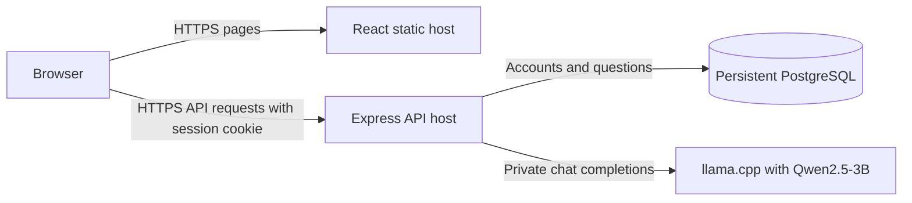

# CodeBridge AI frontend

The React application uses the Express API for registration, login, session restoration, and question management. It includes an administrator page with account counts and a registered-user directory, plus a Qwen-powered wording assistant. Usage reporting is planned for Milestone 2.

## Run locally

Follow the [README quick start](../README.md#getting-started) to configure PostgreSQL and start both services. Keep `CLIENT_ORIGIN=http://localhost:5173` for the default frontend and use `localhost` consistently for both services.

Open [the local frontend](http://localhost:5173). Register and then log in to use question management, or follow the [demo account instructions](authentication.md#seed-the-course-demo-accounts) to exercise both roles in a disposable environment.

Vite uses `http://localhost:3000/api/v1` by default in development. Set `VITE_API_BASE_URL` in `frontend/.env.local` to override it. The root `.env` belongs to Express and PostgreSQL. For example, set `PORT=3300` in the root `.env` and `VITE_API_BASE_URL=http://localhost:3300/api/v1` in `frontend/.env.local`, then restart both servers. Set the API URL in Netlify's build environment for production. Vite exposes `VITE_` variables to browsers, so keep signing secrets, database credentials, and model settings in the backend environment.

## Routes and permissions

The interface reproduces the Question2Answer 1.8 SnowFlat theme: the dark top bar with icon navigation, the grey sub-navigation band, the blue page heading, white list and form panels, the 74.5% / 25% main and sidebar split, and SnowFlat's colours, Ubuntu typography and breakpoints (980, 800 and 768 px). Below 980 px the main navigation becomes a menu and the sidebar slides in from the right, as in SnowFlat. URLs follow Q2A.

| Q2A page | Path | Behavior |
| --- | --- | --- |
| All activity (home) | `/` | Recent questions with their latest event: asked, answered, commented or edited. |
| Questions | `/questions`, `/questions/<category-slug>` | Sub-navigation for Recent, Hot!, Most votes, Most answers and Most views. A category path includes its subcategories. |
| Unanswered | `/unanswered`, `?by=selected`, `?by=upvotes` | No answer, no selected answer, or no upvoted answer. Closed questions are excluded. |
| Tags | `/tags`, `/tag/<tag>` | Most popular tags with counts; a tag page lists its questions and can be added to favorites. |
| Categories | `/categories` | Browse categories and subcategories with question counts. |
| Users | `/users`, `/users/newest`, `/users/special`, `/users/blocked` | Top scoring users with points. Blocked users is for moderators and administrators. |
| User profile | `/user/<handle>` and `/activity`, `/questions`, `/answers` | Member for, level, profile fields, score and rank, activity counts and votes. Administrators can change the level or block the user here. |
| Ask a Question | `/ask` | Title, category, details and tags, with **Improve with AI** and Q2A's similar-question check. |
| Question | `/<id>/<slug>` | Voting, favorite star, answers, comments, best answer, edit (with AI), flag, close/reopen, hide/reshow and delete according to the user's level. Old `/questions/<id>` links redirect here. |
| Search | `/search?q=` | Words matched against titles, details and tags. |
| My account | `/account` | Username, name, location, website, about and password. |
| My favorites | `/favorites` | Favorite questions, users and tags. |
| API usage | `/usage` | The account's counted calls, the 20-call notice and a per-endpoint breakdown. |
| AI assistant | `/assistant` | Standalone AI improvement whose accepted draft continues to the Ask page. |
| Admin | `/admin`, `/admin/users`, `/admin/categories`, `/admin/stats`, `/admin/flagged`, `/admin/hidden`, `/admin/usage` | General options, users, categories and statistics for administrators; flagged and hidden posts for moderators and administrators; API consumption by user and endpoint. |
| Log in / Register | `/login`, `/register` | Log in with an email or username. Registration asks for a username, email and password. The top bar also has Q2A's login drop-down. |

User levels follow Q2A: registered user, expert, editor, moderator and administrator. Editors and above can edit, hide and reshow any post and select best answers; moderators and administrators can permanently delete hidden posts; only administrators can use the admin pages for options, users, categories and statistics. Express enforces every permission independently of the frontend.

The session provider reads `GET /auth/me` at startup and again after login to verify that the browser can send the session cookie. A `401` from a protected application request ends the local session. An interrupted Ask draft stays in memory and is restored when the same account signs back in without reloading the app.

## Frontend structure

```text
frontend/
├── public/                  Brand icon and Netlify SPA rewrite
├── src/
│   ├── components/
│   │   ├── Layout.jsx       Q2A top bar, sub-navigation, sidebar widgets and footer
│   │   ├── q2a.jsx          Vote box, answer count, tags, meta line and question list
│   │   ├── ui.jsx           Notices, pagination, relative times, post content
│   │   ├── QuestionFields.jsx  Ask/edit form fields and validation
│   │   └── Improvement.jsx  AI suggestion comparison
│   ├── context/             Cookie-backed session state
│   ├── hooks/               Resource loading, drafts and AI interaction
│   ├── pages/               Lists, question page, ask, users, account, admin and auth pages
│   ├── services/api.js      Fetch, errors and API contracts
│   ├── App.jsx              Q2A routes and authorization guards
│   ├── App.test.jsx         Interaction tests with mocked HTTP
│   ├── index.css            SnowFlat-style theme (plain CSS)
│   └── main.jsx             React entry point
├── index.html
├── package.json
├── package-lock.json
└── vite.config.js
```

## Express endpoints

All 70 operations are described with request and response examples in Swagger UI at `/doc/` (see [API documentation](api-documentation.md)). Question and answer details use a CKEditor-style rich text editor and are sent as sanitized HTML with `format: 'html'`; comments stay plain text. The editor and API validate trimmed titles at 12–120 UTF-16 code units, details at 0–12,000, answers and comments at 12–12,000 and up to 5 tags. The API limits encoded JSON to 16 KB.

## Local Qwen inference

1. Download and extract a llama.cpp build for your OS and CPU architecture. The CPU build is sufficient. Run `llama-server` from the extracted directory as `./llama-server` on macOS/Linux or `.\llama-server.exe` in PowerShell, or add the directory to your `PATH` to use the command below. [Official llama.cpp releases](https://github.com/ggml-org/llama.cpp/releases)
2. Download Qwen's `qwen2.5-3b-instruct-q4_k_m.gguf` file (about 2.1 GB) to a directory outside the project. [Official Q4_K_M model download](https://huggingface.co/Qwen/Qwen2.5-3B-Instruct-GGUF/blob/main/qwen2.5-3b-instruct-q4_k_m.gguf)
3. Start the server with the full downloaded model path. Leave this terminal running. The alias matches CodeBridge's default model ID. [llama.cpp server options](https://github.com/ggml-org/llama.cpp/blob/master/tools/server/README.md)

```sh
llama-server -m "/path/to/qwen2.5-3b-instruct-q4_k_m.gguf" --host 127.0.0.1 --port 8080 --alias "Qwen/Qwen2.5-3B-Instruct-GGUF:Q4_K_M"
```

Open [the local model endpoint](http://127.0.0.1:8080/v1/models) and confirm that `data[0].id` matches `AI_MODEL` in the root `.env`. If using a different llama.cpp port or model ID, update the corresponding variables and restart Express.

| Backend variable | Default and purpose |
| --- | --- |
| `AI_SERVICE_URL` | `http://127.0.0.1:8080`, the llama.cpp origin |
| `AI_MODEL` | `Qwen/Qwen2.5-3B-Instruct-GGUF:Q4_K_M`, the ID from `/v1/models` |
| `AI_TIMEOUT_MS` | `30000`, a whole number from 1 to 120,000 milliseconds |

React sends the trimmed question title as `{ question }` to Express with the session cookie. Express checks the session and request origin, validates 1–2,000 characters (UTF-16 code units), and calls llama.cpp's `/v1/chat/completions` with a few-shot prompt, temperature 0.2, and a 256-token output limit. The question details stay out of the inference request. Express returns only `{ improvedQuestion }` on success. Accepting a single-line rewrite of 12–120 characters replaces the title in the draft. Other rewrites go above the existing details. Review the result and use **Save Question** to persist it.

The endpoint returns 400 for invalid input, 401 for an invalid or missing session, 403 for a missing or mismatched origin, 502 for an invalid or incomplete model response, 503 when the model cannot serve the request, and 504 on timeout. The UI keeps the draft and offers a retry for inference failures.

To verify real inference, start llama.cpp, PostgreSQL, Express, and Vite, then sign in and enter `why my api returns 404` as a new question title. Select **Improve with AI** and check that the comparison contains a rewrite and the draft only changes after acceptance. Keep llama.cpp on loopback for this setup. A deployed Express service needs its own private network path to llama.cpp, and the deployment request timeout must allow for the configured inference timeout.

## Milestone 2 consumption reporting

`GET /usage` requires a session and returns `totalUsage`, `freeAllowance: 20`, `remainingCalls`, `limitExceeded`, `allowanceExhausted`, and `breakdown` rows (`method`, `endpoint`, `count`, `errorCount`). Compatibility aliases `total` and `threshold` are also returned.

`GET /admin/usage` requires administrator authorization and returns `byUser` (`user_id`, `email`, `count`, including zero-use accounts) and `byEndpoint` (`method`, `endpoint`, `count`, `errorCount`).

The existing layout loads consumption after login/session restoration and refreshes it after question and AI responses, including failed requests and empty 204 responses. The usage page loads the full breakdown. Counts and remaining allowance come from PostgreSQL; the browser does not increment a counter. See [consumption policy and verification](api-usage.md).

## Build and test

See the [README verification commands](../README.md#verification). Frontend tests exercise interactions with mocked HTTP responses. PHP comparison scenarios and source references are in the [Q2A analysis](q2a-analysis.md#comparison-checks-and-results). Running those scenarios requires a separate Q2A fixture.

## Deployment



The frontend and API use separate HTTPS origins. See the [active Netlify and PM2 deployment](production.md#netlify-and-pm2-on-contabo) for the build settings, cookie policy, and smoke tests. The [optional same-site Compose stack](production.md#alternative-same-site-compose-deployment) has its own proxy and cookie settings.
