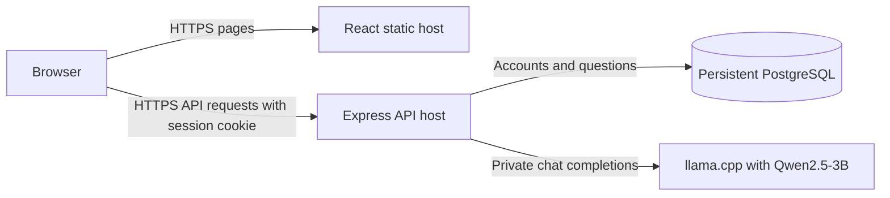

# CodeBridge AI frontend

The React application uses the Express API for registration, login, session restoration, and question management. It includes an administrator page with account counts and a registered-user directory, plus a Qwen-powered wording assistant. Usage reporting is planned for Milestone 2.

## Run locally

Follow the [README quick start](../README.md#getting-started) to configure PostgreSQL and start both services. Keep `CLIENT_ORIGIN=http://localhost:5173` for the default frontend and use `localhost` consistently for both services.

Open [the local frontend](http://localhost:5173). Register and then log in to use question management, or follow the [demo account instructions](authentication.md#seed-the-course-demo-accounts) to exercise both roles in a disposable environment.

Vite uses `http://localhost:3000/api/v1` by default in development. Set `VITE_API_BASE_URL` in `frontend/.env.local` to override it. The root `.env` belongs to Express and PostgreSQL. For example, set `PORT=3300` in the root `.env` and `VITE_API_BASE_URL=http://localhost:3300/api/v1` in `frontend/.env.local`, then restart both servers. Set the API URL in Netlify's build environment for production. Vite exposes `VITE_` variables to browsers, so keep signing secrets, database credentials, and model settings in the backend environment.

## Routes and permissions

| Page | Path | Behavior |
| --- | --- | --- |
| Login | `/login` | Sign in and return to the requested protected page, or open My Questions by default. |
| Registration | `/register` | Create an account and continue to login. |
| My Questions | `/questions` | See the signed-in email, search visible questions, and filter to your own. Administrators can also search and open hidden questions. |
| Question details | `/questions/:id` | Owners can hide their visible questions. Administrators can hide any visible question and reshow or permanently delete hidden questions. |
| Question editor | `/questions/new`, `/questions/:id/edit` | Create or update a question and review AI suggestions. Owners can confirm deletion of their visible questions here. |
| AI Assistant | `/assistant` | Start from a new or visible question and send an accepted suggestion to the editor for review. |
| API Usage | `/usage` | Show eligible calls, progress, notices, and a breakdown when available. |
| Administration | `/admin` | Administrators can see account totals and filter the registered-user directory by email and role. Usage values show as unavailable until the backend supplies them. |
| Profile | `/profile` | Show account email, role, creation date, and logout. |

All signed-in accounts can read visible questions. Owners and administrators can edit visible questions. Hidden questions are omitted from the visible list and regular users receive `403` when opening one, including their own. After hiding a question, a regular owner returns to the visible list. Administrators can stay on the hidden detail page and must reshow the question before editing. A hidden edit URL takes an administrator to the detail view. Express enforces the permissions independently of the frontend.

The session provider reads `GET /auth/me` at startup and again after login to verify that the browser can send the session cookie. If the post-login check returns `401`, the login screen shows a session error and stays open. Browser requests include credentials, and JavaScript keeps the user profile in memory. A `401` from a protected application request ends the local session. An interrupted draft stays in memory and can be restored when the same account signs back in without reloading the app. A startup network error offers a retry.

## Frontend structure

```text
frontend/
├── public/                  Brand icon and Netlify SPA rewrite
├── src/
│   ├── components/          Navigation, feedback, question fields, and AI comparison
│   ├── context/             Cookie-backed session state
│   ├── hooks/               Resource loading and AI interaction
│   ├── pages/               Screens and question moderation tests
│   ├── services/api.js      Fetch, errors, and API contracts
│   ├── App.jsx              Routes and authorization guards
│   ├── App.test.jsx         Interaction tests with mocked HTTP
│   ├── index.css            Responsive design and Tailwind CSS
│   └── main.jsx             React entry point
├── index.html
├── package.json
├── package-lock.json
└── vite.config.js
```

## Implemented Express endpoints

Paths below are relative to `/api/v1`.

| Endpoint | Request and successful response |
| --- | --- |
| `POST /auth/register` | `{ email, password }` → 201 with `{ user }` |
| `POST /auth/login` | `{ email, password }` → 200 with `{ user }` and a cookie |
| `GET /auth/me` | 200 with `{ user }` |
| `POST /auth/logout` | 204 and cookie expiration |
| `GET /questions` | 200 with `{ questions }` containing visible questions only |
| `GET /questions/hidden` | Administrator only. 200 with `{ questions }` containing hidden questions only |
| `GET /questions/:id` | 200 with `{ question }`. Hidden questions require an administrator |
| `POST /questions` | `{ title, body }` → 201 with `{ question }` |
| `PATCH /questions/:id` | An owner or administrator can edit a visible question. `{ title, body }` → 200 with `{ question }`. With a valid body, a hidden question returns 409 for an administrator and 403 for a regular user |
| `POST /questions/:id/hide` | An owner or administrator can hide a visible question. 204 for a regular owner, or 200 with `{ question }` for an administrator |
| `POST /questions/:id/reshow` | Administrator only. 200 with `{ question }` after reshowing a hidden question |
| `DELETE /questions/:id` | 204 for the owner of a visible question or an administrator deleting a hidden question |
| `GET /admin/dashboard` | Administrator only. 200 with `{ users, admins }` containing counts by role |
| `GET /admin/users` | Administrator only. 200 with `{ users: [{ id, email, role, created_at }] }` |
| `POST /ai/improve-question` | `{ question }` → 200 with `{ improvedQuestion }` |

The editor and API validate trimmed titles at 12–120 UTF-16 code units and trimmed details at 0–12,000. The API also limits encoded JSON to 16 KB. A draft with many multibyte or escaped characters can reach the request limit before the editor's length limit. The editor preserves the draft and displays an error.

The Milestone 1 directory response contains account IDs, emails, roles, and creation timestamps. The frontend can show an unavailable directory when an older API returns `404`, `405`, or `501`. A matching Milestone 1 deployment serves the directory on `GET /admin/users`.

## Local Qwen inference

Start `llama-server` with your existing Qwen2.5-3B-Instruct GGUF file. On Windows, invoke `llama-server.exe` from its installation directory or add it to your PATH. The alias in this example matches CodeBridge's default model ID. See the [llama.cpp server documentation](https://github.com/ggml-org/llama.cpp/blob/master/tools/server/README.md) for server options.

```sh
llama-server -m "/path/to/Qwen2.5-3B-Instruct-Q4_K_M.gguf" --host 127.0.0.1 --port 8080 --alias "Qwen/Qwen2.5-3B-Instruct-GGUF:Q4_K_M"
```

Check `curl http://127.0.0.1:8080/v1/models`. If your server is already running, use the model ID it reports.

| Backend variable | Default and purpose |
| --- | --- |
| `AI_SERVICE_URL` | `http://127.0.0.1:8080`, the llama.cpp origin |
| `AI_MODEL` | `Qwen/Qwen2.5-3B-Instruct-GGUF:Q4_K_M`, the ID from `/v1/models` |
| `AI_TIMEOUT_MS` | `30000`, a whole number from 1 to 120,000 milliseconds |

React sends the trimmed question title as `{ question }` to Express with the session cookie. Express checks the session and request origin, validates 1–2,000 characters (UTF-16 code units), and calls llama.cpp's `/v1/chat/completions` with a few-shot prompt, temperature 0.2, and a 256-token output limit. The question details stay out of the inference request. Express returns only `{ improvedQuestion }` on success. Accepting a single-line rewrite of 12–120 characters replaces the title in the draft. Other rewrites go above the existing details. Review the result and use **Save Question** to persist it.

The endpoint returns 400 for invalid input, 401 for an invalid or missing session, 403 for a missing or mismatched origin, 502 for an invalid or incomplete model response, 503 when the model cannot serve the request, and 504 on timeout. The UI keeps the draft and offers a retry for inference failures.

To verify real inference, start llama.cpp, PostgreSQL, Express, and Vite, then sign in and enter `why my api returns 404` as a new question title. Select **Improve with AI** and check that the comparison contains a rewrite and the draft only changes after acceptance. Keep llama.cpp on loopback for this setup. A deployed Express service needs its own private network path to llama.cpp, and the deployment request timeout must allow for the configured inference timeout.

## Remaining Milestone 2 integration

The following interfaces are proposed contracts. Update the corresponding functions in `frontend/src/services/api.js` if the backend adopts different paths or shapes. Missing routes (HTTP 404, 405, or 501) produce unavailable states. Transient API or network errors offer a retry.

| Endpoint | Proposed JSON contract |
| --- | --- |
| `GET /usage` | Return `{ total, threshold, breakdown? }`. The optional breakdown contains `{ method, endpoint, count, errorCount? }` rows. |
| `GET /admin/usage` | Return `{ byUser: [{ user_id, email, count }], byEndpoint: [{ method, endpoint, count, errorCount? }] }`. |

These endpoints require a session. The administrator usage endpoint also requires administrator authorization. The database schema includes `api_usage`. Backend request tracking and reporting still need implementation. The intended notice threshold is 20 eligible requests. Requests continue after the threshold. Registration, login, logout, documentation, and CORS preflight are excluded.

## Build and test

See the [README verification commands](../README.md#verification). Frontend tests exercise interactions with mocked HTTP responses. PHP comparison scenarios and source references are in the [Q2A analysis](q2a-analysis.md#comparison-checks-and-results). Running those scenarios requires a separate Q2A fixture.

## Deployment



The frontend and API use separate HTTPS origins. See the [active Netlify and PM2 deployment](production.md#netlify-and-pm2-on-contabo) for the build settings, cookie policy, and smoke tests. The [optional same-site Compose stack](production.md#alternative-same-site-compose-deployment) has its own proxy and cookie settings.
